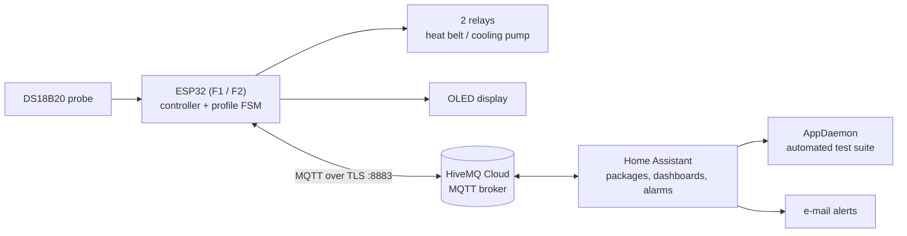
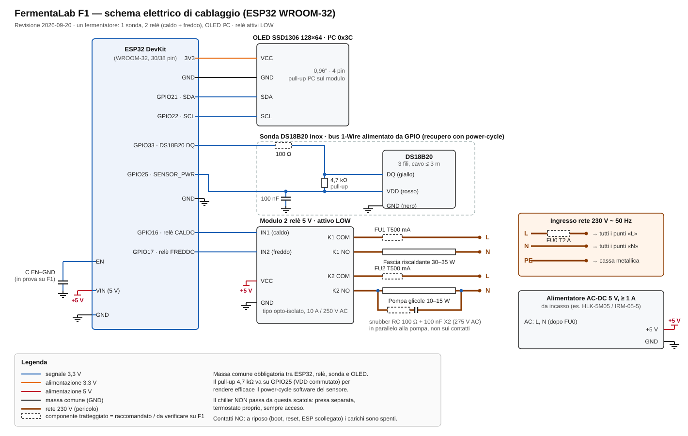

# FermentaLab — ESP32 fermentation temperature controller with Home Assistant

[](https://www.arduino.cc/)
[](https://www.espressif.com/en/products/socs/esp32)
[](https://www.hivemq.com/)
[](https://www.home-assistant.io/)
[](LICENSE)

Open hardware + firmware + Home Assistant setup for a **beer-fermentation temperature controller**. An ESP32
reads a DS18B20 probe, drives a heating belt and a glycol-cooling pump through two relays, follows a
multi-step fermentation profile (ramps and holds), and talks MQTT to Home Assistant for dashboards,
alarms, e-mail alerts and an automated on-hardware test suite.

It started as a **school project** and is also built to be a **teaching tool**: a *didactic mode* lets students
swap control algorithms (on/off, hysteresis, P, PI, PID), watch the P, I and D terms live and run step-response
experiments on a real tank, without beer. See [Learning with it](#learning-with-it-didactic-mode).

> **Status (2026-09-20).** The active firmware is `fermentatore_v6` (source version **6.4.1**). One
> controller, **F1**, exists as a bench unit running 6.3.0 and is being validated with an automated test
> suite before real beer goes in. A second one, **F2**, exists only as a software identity and a design
> ([`13_F2_SCHEDA_INDIPENDENTE.md`](firmware/fermentatore_v6/docs/13_F2_SCHEDA_INDIPENDENTE.md)). There is a
> **known hardware fault under investigation** (spontaneous ESP32 resets, see [Known issues](#known-issues)).
> Treat this as a working project, not a finished product.

The documentation under `firmware/fermentatore_v6/docs/` is written in **Italian**; this README is the
English entry point.

---

## Contents

1. [How it works](#how-it-works)
2. [Learning with it (didactic mode)](#learning-with-it-didactic-mode)
3. [Repository layout](#repository-layout)
4. [Hardware: schematic, pin map, bill of materials](#hardware)
5. [Firmware: build, configure, flash](#firmware)
6. [Home Assistant setup](#home-assistant)
7. [Testing](#testing)
8. [Known issues](#known-issues)
9. [Security and secrets](#security-and-secrets)
10. [Documentation index](#documentation-index)
11. [License](#license)

---

## How it works



- **Control.** Modes `on_off`, `on_off_hyst_sym`, `on_off_hyst_asym`, `P`, `PI`, `PD`, `PID` (anti-windup,
  filtered derivative on the measurement, deadband, 600 s PWM window). Settings, gains and the running profile
  are stored in NVS, so after a reboot the controller resumes the same profile at the same point in time.
- **Profiles.** Multi-step JSON recipes with constant holds and linear ramps
  ([`firmware/fermentatore_v6/profili/`](firmware/fermentatore_v6/profili/)). Timing is local and pausable
  (no jump when NTP resyncs).
- **Safety, always active regardless of Home Assistant.** Relays off if the last valid reading is older than
  20 s; absolute limits 36 °C / −1 °C; setpoint clamped to 0–35 °C; a relay stays on at least 30 s and off at
  least 60 s, with a 60 s pause between heating and cooling; 60 s watchdog; commands older than 10 minutes,
  repeated, or arriving retained are rejected; the sensor watchdog power-cycles a stuck probe.
- **Home Assistant.** MQTT entities, alarms (out of range, data stopped, ESP offline, abnormal reboot), didactic
  and production modes, dashboards, and a resumable AppDaemon suite that runs scripted tests on the real device.
- **MQTT contract.** Topics under `fermentazione/v6/{id}/` (`esp/state`, `esp/controllo`, `esp/availability`,
  `esp/ack`, `esp/log`, `ha/cmd/start|stop|reboot|profile_set|control_set`). Full contract:
  [`04_CONTRATTO_HASS.md`](firmware/fermentatore_v6/docs/04_CONTRATTO_HASS.md).

---

## Learning with it (didactic mode)

The bench unit is a fermenter filled with **water**, so it is safe to push it around, and it behaves like a
real, slow thermal system (temperature moves over hours, not seconds). That makes it a good lab for control
theory: students can see why a simple thermostat chatters, what hysteresis buys, and what P, I and D each do.

**Three modes** (a selector in Home Assistant, `Produzione` / `Didattica` / `Collaudo`):

| Mode | Use | What is allowed |
|---|---|---|
| Production | Beer in the tank | Start, pause, stop profiles. Control parameters read-only, experiments locked |
| **Didactic** | Tank without beer | Presets, parameters, switching algorithm, setpoint steps; no e-mail alerts, only an HA notification |
| Test ("collaudo") | Automated test suite | Only the test engine sends commands |

The lock is enforced in Home Assistant (the firmware accepts any valid command), and switching back to
Production always restores the production control (on/off with 0.5 °C hysteresis).

**What the "F1 Laboratorio" dashboard shows** (views *Overview · Laboratory · Experiments · Fermentation · Diagnostics*):

- a live explanation of the algorithm that is running, with the current numbers plugged in;
- temperature, setpoint, SP ± h thresholds and relay state on one chart, and the **P, I and D terms and the
  controller output** on another (the firmware publishes them on `esp/controllo` since 6.3.0);
- **presets** to compare, tuned with 48-hour simulations on a 20 L tank: on/off with 0.5 °C or 1.0 °C
  hysteresis, pure on/off, P, the recommended PI, PID, and a deliberately **badly tuned PI** to see what goes wrong;
- **setpoint-step experiments** with automatic metrics — overshoot, settling time (within ±0.2 °C for
  30 min), mean error, number of relay switchings — and a log of the results.

**Ideas for exercises** (suggestions, not a fixed curriculum): compare relay wear between pure on/off and
hysteresis; tune a PI by hand and read the integral term; see what the derivative does to a noisy
measurement; find out why the badly tuned PI is slow or oscillates.

**No hardware needed to start.** The host test suite runs the real firmware against a thermal model of the
tank, including 48 h simulations of on/off, PI and PID ([Testing](#testing)), so the same questions can be
explored on a PC first.

Honest limits: some presets (the badly tuned PI, pure on/off) have so far only been run in simulation, not
live on F1, and the experiment view does not yet compare two runs side by side
([`10_PUNTI_APERTI.md §6`](firmware/fermentatore_v6/docs/10_PUNTI_APERTI.md)). Details and the step-by-step
procedure: [`05_HOME_ASSISTANT_F1.md`](firmware/fermentatore_v6/docs/05_HOME_ASSISTANT_F1.md) (§2 modes, §5 dashboards and presets, §6 procedures).

---

## Repository layout

```text
FermentaLab/
├── README.md                     this file
├── LICENSE                       MIT
├── CLAUDE.md                     guidance for AI coding agents working on the repo
├── MODALITA_ACCESSO_LAB.md       how an agent reaches a Home Assistant instance (MCP / REST / SSH), with placeholders
├── hardware/
│   ├── schema_elettrico_f1.svg   wiring schematic of F1 (below)
│   ├── genera_schema.py          script that generates the SVG (edit and re-run to change the drawing)
│   └── bom_f1.csv                bill of materials
├── firmware/
│   ├── fermentatore_v6/          ACTIVE
│   │   ├── fermentatore_v6/      the Arduino sketch (.ino + modules) — open this folder in the Arduino IDE
│   │   ├── docs/                 numbered documentation (start with 00_INDICE.md)
│   │   ├── hass_spec/            Home Assistant packages, dashboards, AppDaemon test engine
│   │   ├── profili/              fermentation profile catalog (JSON)
│   │   ├── tests/                host tests (mocks) and offline simulator of the test suite
│   │   └── tools/v6/             target configurator, build-info tooling, E2E MQTT test
│   └── obsolete/                 frozen v2–v5 line, reference only
└── homeassistant/                Home Assistant configuration snapshot, start script, secrets template
```

---

## Hardware

> ⚠️ **Mains voltage.** The heater and the pump run on 230 V AC. Build the low-voltage part and test it with
> the loads disconnected first. Have the mains wiring made or checked by someone qualified, use fuses and an
> enclosure rated for the environment (condensation, glycol), connect protective earth, and never work on it
> while it is plugged in. You are responsible for your installation.

### Schematic (F1, ESP32 WROOM-32)



Dashed components are recommended but not yet verified on the bench unit. The drawing is generated by
[`hardware/genera_schema.py`](hardware/genera_schema.py). The reference documents are
[`02_HARDWARE_E_TARGET.md`](firmware/fermentatore_v6/docs/02_HARDWARE_E_TARGET.md) (pin map, checklist) and
[`12_HARDWARE_DUAL_F1_F2.md`](firmware/fermentatore_v6/docs/12_HARDWARE_DUAL_F1_F2.md) (noise protection, enclosure).

### Pin map

| Function | ESP32 WROOM GPIO (F1) | ESP32-S3 Super Mini GPIO | Notes |
|---|---:|---:|---|
| DS18B20 DQ | 33 | 4 | 4.7 kΩ pull-up to the *switched* VDD (see below) |
| DS18B20 VDD (switched) | 25 | 5 | Lets the firmware power-cycle a stuck probe |
| Relay heat IN1 | 16 | 6 | Active LOW |
| Relay cool IN2 | 17 | 7 | Active LOW (cooling pump) |
| OLED SDA | 21 | 8 | I²C |
| OLED SCL | 22 | 9 | I²C |

- Relay logic is **active LOW** (`RELAY_ON = LOW`). Relays must stay off during boot and reset.
- Common ground between the ESP32, the relay module, the probe and the OLED is mandatory.
- Wire the 4.7 kΩ pull-up to GPIO25 (the switched VDD), **not** to fixed 3V3: with a fixed 3V3 pull-up the probe
  keeps running in parasitic mode and the software power-cycle does nothing.
- Never put 5 V on a GPIO. The WROOM-32 is the tested target; the S3 map is provided but unused.
- F2 (planned) uses the same map plus a second probe for the glycol bath on GPIO27 (DQ) / GPIO23 (VDD).

### Bill of materials (per fermenter)

Also as [`hardware/bom_f1.csv`](hardware/bom_f1.csv). *Status* says whether the item is on the bench unit F1.

| Ref | Qty | Component | Specification | Status |
|---|---:|---|---|---|
| U1 | 1 | ESP32 DevKit V1 (ESP32-WROOM-32) | 30/38-pin, 5 V on VIN; board "ESP32 Dev Module" | F1 as built |
| B1 | 1 | DS18B20 waterproof probe | Stainless steel, 3 wires, cable 1–3 m | F1 as built |
| R1 | 1 | Resistor 4.7 kΩ | Pull-up DQ ↔ switched VDD (GPIO25) | F1 as built |
| R2 | 1 | Resistor 100 Ω | In series with DQ | Recommended |
| C1 | 1 | Capacitor 100 nF ceramic | Switched VDD ↔ GND at the probe terminal | Recommended |
| C2 | 1 | Capacitor EN ↔ GND | Value under validation (fix for the resets) | Under test |
| K1 | 1 | 2-channel relay module, 5 V | Active LOW, 10 A / 250 V AC, opto-isolated recommended | F1 as built |
| DS1 | 1 | OLED SSD1306 0.96″ 128×64 | I²C 0x3C, 4 pins | F1 as built |
| PS1 | 1 | AC-DC supply 5 V ≥ 1 A | e.g. HLK-5M05 / IRM-05-5, or a 5 V / 2 A USB adapter | Type to confirm |
| FU0 | 1 | Fuse T2 A 5×20 + holder | Mains input | Recommended |
| FU1, FU2 | 2 | Fuse T500 mA 5×20 + holders | One per output | Recommended |
| Z1, Z2 | 2 | RC snubber 100 Ω + 100 nF X2 (275 V AC) | Across each load, not across the contacts | Recommended (testing) |
| E1 | 1 | Enclosure IP54+, cable glands, terminals, insulating barrier | Separate mains and low-voltage zones | Recommended |
| H1 | 1 | Silicone heating belt 30–35 W, 230 V | On K1 | F1 as built |
| P1 | 1 | Circulation pump 230 V, 10–15 W | Glycol through the jacket; on K2 | F1 as built |
| CH1 | 1 | Glycol chiller (~1/5 HP) with its own thermostat | Always on, **separate** mains socket, not switched by this box | F1 as built |
| T1 | 1 | Fermenter with glycol jacket, propylene glycol, hoses | Sized to the batch | F1 as built |

### Building it (suggested order)

1. Assemble the low-voltage side on a bench: ESP32, OLED, probe, relay module, 5 V supply. No loads.
2. Flash the firmware ([below](#firmware)) and check the OLED, the temperature and that both relays click on
   command and stay **off** at power-up and reset.
3. Run through the pre-test checklist in [`02_HARDWARE_E_TARGET.md §6`](firmware/fermentatore_v6/docs/02_HARDWARE_E_TARGET.md).
4. Only then wire the 230 V side (fuses, snubbers, terminals, earth) with the plug out, loads last.
5. Fill the fermenter with **water**, run the automated test suite ([Testing](#testing)), and only then use beer.

---

## Firmware

**Toolchain: Arduino IDE 2.x** (no PlatformIO). Tested with the Espressif **`esp32` core 3.x** (3.3.7).

Libraries (Library Manager): **PubSubClient**, **ArduinoJson** 6.x, **OneWire**, **DallasTemperature**,
**U8g2**. The rest (WiFi, WiFiClientSecure, ArduinoOTA, Preferences, esp_task_wdt) ships with the core.

```powershell
# from the repository root
cd firmware
# 1. credentials (this file is git-ignored)
copy fermentatore_v6\fermentatore_v6\secrets.h.template fermentatore_v6\fermentatore_v6\secrets.h
```

Edit `secrets.h`:

| Macro | Meaning |
|---|---|
| `HOTSPOT_PASS` | Password of the phone hotspot used for OTA updates |
| `OTA_PASSWORD` | Password asked by the Arduino IDE for wireless flashing |
| `MQTT_SERVER` / `MQTT_USER` / `MQTT_PASS` | Your MQTT broker, e.g. a free [HiveMQ Cloud](https://www.hivemq.com/mqtt-cloud-broker/) cluster (TLS, port 8883) |
| `WIFI_MAC_PASSWORD_MAP` | One line per device: `if (macAddress == "AA:BB:CC:DD:EE:FF") { return "wifi_password"; }` — print `WiFi.macAddress()` on the serial monitor to get the MAC |

Then in `fermentatore_v6/fermentatore_v6/config.h` adjust what is specific to your site:
`WIFI_SSID` (default `"IoT"`), `HOTSPOT_SSID` (default `"HotIoT"`), `NTP_OFFSET`/`NTP_DST` (default: Italy, UTC+1
with DST) and `OLED_I2C_ADDR`.

Choose the target (F1/F2 × WROOM/S3). The configurator writes `DEVICE_FERMENTER_ID`, `DEVICE_HARDWARE_TARGET`
and the pin map into `config.h` (PowerShell; on other systems edit `config.h` by hand following the pin map):

```powershell
powershell -NoProfile -ExecutionPolicy Bypass -File fermentatore_v6\tools\v6\configure_target.ps1 -TargetId wroom-f1
```

**Flash.** Open `firmware/fermentatore_v6/fermentatore_v6/fermentatore_v6.ino`, select *ESP32 Dev Module*, and
upload over USB the first time. Later updates can go over the air, but note: the ESP32 looks for the hotspot
**only at boot**, and managed / corporate WiFi often blocks OTA traffic — a phone hotspot is the reliable
option, and the PC must be on that same hotspot.

**Check.** After boot the OLED shows the version and WiFi; MQTT shows `esp/availability = online` and an
`esp/state` message every 30 s. Runbook and smoke tests: [`08_RUNBOOK_OPERATIVO.md`](firmware/fermentatore_v6/docs/08_RUNBOOK_OPERATIVO.md).

Version policy: every substantial change gets an entry in
[`firmware/fermentatore_v6/CHANGELOG.md`](firmware/fermentatore_v6/CHANGELOG.md), and `FIRMWARE_VERSION`
(`config.h`, the OLED splash in `display.cpp`, the `"firmware"` field in `connettivita.cpp`) follows it.

---

## Home Assistant

Requirements: Home Assistant with the **MQTT** integration on the same broker as the firmware. Optional:
the **AppDaemon** add-on (test suite), InfluxDB, an SMTP server (e-mail alerts).

Short version — details and the exact file list are in
[`homeassistant/README.md`](homeassistant/README.md) and
[`05_HOME_ASSISTANT_F1.md`](firmware/fermentatore_v6/docs/05_HOME_ASSISTANT_F1.md):

1. Back up the instance.
2. Copy `homeassistant/*` into `/config` (merge, don't overwrite), fill `secrets.yaml` from
   `secrets.yaml.template`, and create `scripts_py/mqtt_broker.json` from its template (a long-lived token).
3. Copy `firmware/fermentatore_v6/hass_spec/packages/*` to `/config/packages/`, the dashboards to `/config/`,
   and `firmware/fermentatore_v6/profili/*.json` to `/config/profili_fermentazione/`.
4. Check the configuration, reload, open the dashboards *F1 Laboratorio* / *F1 Collaudo*.

> **Do not enable MQTT discovery on a broker shared with real hardware**, and remember that anything Home
> Assistant publishes on `fermentazione/v6/<id>/ha/cmd/*` reaches the physical device.

---

## Testing

| Level | How | What it covers |
|---|---|---|
| Host tests (minutes, no hardware) | `powershell -File firmware\fermentatore_v6\tests\host\run_tests.ps1` (needs MSVC Build Tools) | The real firmware sources compiled against Arduino/ESP32 mocks: **22 scenarios**, including 48 h thermal simulations |
| Offline test-suite simulator | `python firmware/fermentatore_v6/tests/collaudo/simula_collaudo.py` | The real AppDaemon test engine against a modeled fermenter, in seconds |
| On-hardware collaudo (hours to days) | AppDaemon app in Home Assistant | Scripted tests over real MQTT with numeric pass criteria: sensor recovery, relay switching, profile ramps, alarms — [`06_COLLAUDO_F1.md`](firmware/fermentatore_v6/docs/06_COLLAUDO_F1.md) |
| E2E MQTT | `firmware/fermentatore_v6/tools/v6/test_e2e.py` (broker credentials via `MQTT_SERVER`, `MQTT_USER`, `MQTT_PASS` environment variables) | Command/ack/state contract against a live device |

Test plan: [`07_TEST_PLAN.md`](firmware/fermentatore_v6/docs/07_TEST_PLAN.md).

---

## Known issues

- **Spontaneous ESP32 resets on F1.** Two distinct symptoms were recorded. (1) On 2026-09-18 the ESP32 reset
  (`poweron`) 0.7–4 s after the cooling-pump relay switched, 3 times in 26 cycles: probably switching noise on the
  supply or the EN pin. Remedies being tried: EN–GND capacitor, RC snubber on the pump, separate relay-coil
  supply. (2) On 2026-09-20 the automated tests logged three resets with reason `wdt` (a watchdog other than
  the task and interrupt watchdogs) during long runs, and two tests failed because of them. The cause is **not
  yet known** (software hang and power quality are both possible). Details:
  [`06_COLLAUDO_F1.md §7`](firmware/fermentatore_v6/docs/06_COLLAUDO_F1.md),
  [`10_PUNTI_APERTI.md`](firmware/fermentatore_v6/docs/10_PUNTI_APERTI.md).
  Keep this in mind for any relay-driving hardware you build.
- `firmware/fermentatore_v6/v6_manifest.json` and its build-info scripts are a separate, stale mechanism: they
  never read `FIRMWARE_VERSION` from `config.h`. See [`09_TOOLING.md`](firmware/fermentatore_v6/docs/09_TOOLING.md).
- Autotuning is implemented but disabled (`AUTOTUNE_ABILITATO 0`).

---

## Security and secrets

Nothing in this repository should contain a credential, a token or a private address.

- Firmware: `secrets.h` is git-ignored; only `secrets.h.template` is versioned.
- Home Assistant: `secrets.yaml` and `scripts_py/mqtt_broker.json` are git-ignored; only templates are versioned.
- The E2E test reads `.env` (git-ignored) from `firmware/fermentatore_v6/tools/v6/`; copy `.env.example` there.
- Anything named `*.local.md`, `*.local.env`, `.env` is ignored as well (per-machine addresses and keys).

| Real file (never committed) | Start from |
|---|---|
| `firmware/fermentatore_v6/fermentatore_v6/secrets.h` | `secrets.h.template` (same folder) |
| `homeassistant/secrets.yaml` (→ `/config/secrets.yaml`) | `homeassistant/secrets.yaml.template` |
| `/config/scripts_py/mqtt_broker.json` on the Home Assistant host | `homeassistant/scripts_py/mqtt_broker.json.template` |
| `firmware/fermentatore_v6/tools/v6/.env` | `firmware/fermentatore_v6/tools/v6/.env.example` |
- If you ever publish credentials by mistake, **rotate them** (broker password, OTA password, tokens); removing
  the file from a later commit does not remove it from history.
- Working with an AI coding assistant on a live Home Assistant: see [`MODALITA_ACCESSO_LAB.md`](MODALITA_ACCESSO_LAB.md)
  (never touch a personal instance, back up before writing, never print tokens).

---

## Documentation index

Start at [`firmware/fermentatore_v6/docs/00_INDICE.md`](firmware/fermentatore_v6/docs/00_INDICE.md) (Italian):
hardware and targets (02), MQTT protocol and contract (03, 04), Home Assistant (05), automated collaudo (06),
test plan (07), runbook (08), open items (10), profile timing (11), the F2 design (12, 13).
The legacy v2–v5 line is described in [`firmware/obsolete/README.md`](firmware/obsolete/README.md).

---

## License

MIT — see [LICENSE](LICENSE). Copyright © 2026 Simone Giuri.
