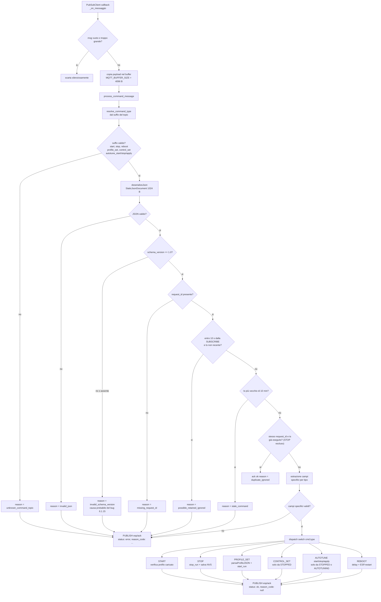

# 03. Protocollo di comunicazione MQTT — Fermentatore V6

**Versione documento**: 1.0 (2026-09-19, contenuti dal 2026-05-25) · **Stato**: corrente, da
allineare quando cambia il contratto

> Aggiornato al firmware **6.2.0** (disponibilità retained, filtro comandi retained/duplicati/vecchi);
> lo schema `esp/controllo` in figura è del 6.3.0. Livello: trasporto/comunicazione, con diagrammi di
> sequenza e di validazione — per lo schema esaustivo di ogni payload vedi
> [04_CONTRATTO_HASS.md](04_CONTRATTO_HASS.md).

---

## 1. Flusso messaggi (sequenza)

```mermaid
sequenceDiagram
    autonumber
    participant HA as Home Assistant
    participant Broker as MQTT Broker TLS 8883
    participant ESP as ESP32 fermentatore-v6-f1

    rect rgb(230, 240, 255)
        Note over ESP: BOOT
        ESP->>+Broker: CONNECT client_id=esp32_v6_f1
        Note over ESP,Broker: LWT topic=esp/availability payload=offline retain=true
        Broker-->>-ESP: CONNACK
        ESP->>Broker: PUBLISH esp/availability online retain=true
        ESP->>Broker: SUBSCRIBE fermentazione/v6/f1/ha/cmd/# QoS 1
        Broker-->>ESP: SUBACK
        Note over ESP: per 10 s i comandi senza ts recente sono trattati come retained e ignorati
        ESP->>Broker: PUBLISH esp/state retain=true (dopo la prima lettura valida)
    end

    rect rgb(240, 255, 240)
        Note over ESP: HEARTBEAT ogni 30 s e subito al cambio relè o FSM
        loop STATUS_INTERVAL_MS 30000 ms
            ESP->>Broker: PUBLISH esp/state retain=true
            Broker--)HA: deliver state
        end
    end

    rect rgb(255, 255, 230)
        Note over HA: COMANDO HA verso ESP32
        HA->>Broker: PUBLISH ha/cmd/start QoS 1
        Note over HA: payload richiede schema_version e request_id
        Broker->>ESP: deliver QoS 1
        ESP->>Broker: PUBACK
        Note over ESP: callback - parse_command - dispatch
        alt comando valido e FSM permette
            ESP->>Broker: PUBLISH esp/ack status=ok request_id=uuid
            Broker--)HA: deliver ack ok
        else schema_version assente o errata
            ESP->>Broker: PUBLISH esp/ack status=error reason=invalid_schema_version
            Broker--)HA: deliver ack error
        else request_id mancante
            ESP->>Broker: PUBLISH esp/ack status=error reason=missing_request_id
            Broker--)HA: deliver ack error
        else precondizione FSM non soddisfatta
            ESP->>Broker: PUBLISH esp/ack status=error reason=no_profile
            Broker--)HA: deliver ack error
        end
    end

    rect rgb(255, 235, 235)
        Note over ESP: ALLARME SENSORE
        Note over ESP: nessuna lettura valida da 20 s: relè OFF
        ESP->>Broker: PUBLISH esp/alarm tipo=sensore_instabile
        Note over ESP: dopo 5 min
        ESP->>Broker: PUBLISH esp/alarm tipo=sensore_offline
        Broker--)HA: deliver alarm
        Note over ESP: dopo 30 s riavvio controllato (max 3 consecutivi, poi riavvio_sospeso)
        ESP->>Broker: PUBLISH esp/availability offline retain=true
    end

    rect rgb(245, 235, 255)
        Note over ESP: PERDITA WiFi e RECONNECT
        ESP--xBroker: TCP drop
        Broker->>HA: LWT esp/availability offline (retained)
        Note over ESP: controllo temperatura invariato; tentativi non bloccanti 3 x 5 s poi ogni 30 s
        ESP->>+Broker: RECONNECT
        Broker-->>-ESP: CONNACK
        ESP->>Broker: PUBLISH esp/availability online retain=true
        ESP->>Broker: SUBSCRIBE ha/cmd/# QoS 1
        ESP->>Broker: PUBLISH esp/state retain=true
        Broker--)HA: deliver stato aggiornato
    end
```

---

## 2. Pipeline di validazione comando (lato ESP32)



---

## 3. Topic contract completo

```mermaid
flowchart LR
    subgraph HA["Home Assistant pubblica"]
        direction TB
        C1["ha/cmd/start"]
        C2["ha/cmd/stop"]
        C3["ha/cmd/reboot"]
        C4["ha/cmd/profile_set"]
        C5["ha/cmd/control_set"]
        C6["ha/cmd/autotune_start"]
        C7["ha/cmd/autotune_stop"]
        C8["ha/cmd/autotune_apply"]
    end

    subgraph ESP["ESP32 pubblica"]
        direction TB
        S1["esp/state  retain=true ogni 30 s e al cambio relè/FSM"]
        S2["esp/ack  per ogni comando ricevuto"]
        S3["esp/alarm  eventi sensore"]
        S7["esp/availability  online / LWT offline, retain=true"]
        S8["esp/controllo  errore, P, I, D, uscita, parametri attivi, retain=true (6.3.0)"]
        S4["esp/log  LOG_I/W/E"]
        S5["esp/autotune_state  ogni 2 s durante AT"]
        S6["esp/autotune_result  a completamento AT"]
    end

    Broker(["MQTT Broker<br/>fermentazione/v6/f1/"])

    HA -->|QoS 1| Broker
    Broker -->|"wildcard #"| ESP
    ESP --> Broker
    Broker --> HA
```



---

## 4. Formato payload comandi obbligatorio (da 6.1.15)

Ogni comando pubblicato da HA **deve** contenere i campi base:

```json
{
  "schema_version": "1.0",
  "request_id": "<uuid-univoco>",
  "ts": 1748000000
}
```

Campi aggiuntivi per comandi specifici:

| Comando | Campi aggiuntivi richiesti |
|---|---|
| `start` | — |
| `stop` | — |
| `reboot` | — |
| `profile_set` | intero JSON profilo (`nome`, `steps[]`, …) |
| `control_set` | `"control_mode"`: `"on_off"` / `"P"` / `"PI"` / `"PD"` / `"PID"` + opzionale `"params":{kp_heat,ki_heat,kd_heat,kp_cool,ki_cool,kd_cool}` |
| `autotune_start` | — |
| `autotune_stop` | — |
| `autotune_apply` | opzionale `"require_quality_score_gte"`: float |

---

## 5. Come diagnosticare comandi rifiutati

1. Aprire il monitor MQTT di HA (o MQTT Explorer)
2. Ascoltare `fermentazione/v6/f1/esp/ack`
3. Inviare un comando da HA
4. Se arriva un messaggio con `"status":"error"`, il `reason_code` indica il gate fallito:

| `reason_code` | Causa |
|---|---|
| `invalid_schema_version` | manca `"schema_version":"1.0"` nel payload |
| `missing_request_id` | manca o vuoto `"request_id"` |
| `invalid_json` | payload non JSON valido |
| `unknown_command_topic` | topic non tra quelli sottoscritti |
| `no_profile` | START inviato senza profilo caricato |
| `unsupported_control_mode` | valore `control_mode` non riconosciuto |
| `possible_retained_ignored` | comando arrivato alla (ri)connessione senza `ts` recente: probabile retained sul broker |
| `stale_command` | `ts` più vecchio di 10 minuti |
| `duplicate_ignored` (status ok) | stesso `request_id` e `ts` già eseguito |
| `mode_change_requires_stopped_state` | `control_set` con modo diverso durante RUNNING |
| `mode_already_active` (status ok) | `control_set` con lo stesso modo durante RUNNING: parametri aggiornati |
| `invalid_pid_params` | guadagni non numerici o negativi |
| `invalid_isteresi` | isteresi fuori da 0,1–3,0 °C (firmware 6.3.0) |
| `too_many_steps`, `step_temp_out_of_range`, `step_temp_missing`, `step_duration_missing`, `step_duration_invalid`, `invalid_avvio_epoch` | profilo rifiutato per intero |
| `autotune_disabled` | autotune disabilitato nel firmware 6.2.0 |
