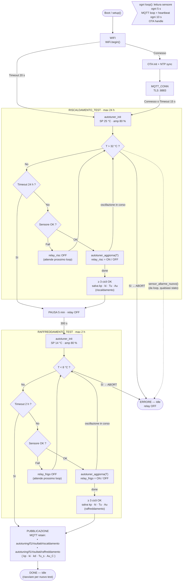
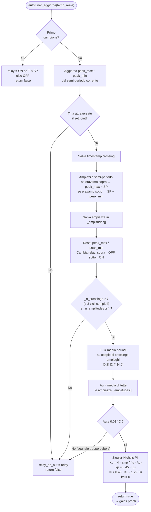

# Diagrammi di flusso — fermentatore_v5_autotuning

## FSM principale

---

## Algoritmo interno — `autotuner_aggiorna(T)`
*(Relay-feedback Åström–Hägglund)*

---

## Note

- La FSM è **one-shot**: parte da `WIFI` e termina in `DONE` o `ERRORE`. Per rifare il test si riavvia l'ESP32.
- L'allarme sensore (`sensor_allarme_nuovo`) è controllato **fuori** dalla FSM in ogni `loop()`: da qualsiasi stato può portare in `ERRORE`.
- Se il test finisce in **timeout** (nessuna oscillazione convergente), lo stato avanza comunque (risc → PAUSA, frigo → PUBBLICAZIONE) ma il relativo risultato non viene pubblicato su MQTT.
- L'autotuner opera con il **sensore letto ogni 5 s** (`SENSOR_READ_INTERVAL_MS`), quindi ogni chiamata a `autotuner_aggiorna` lavora su una nuova misura ogni 5 secondi.
